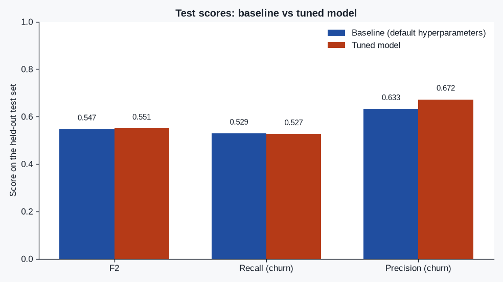
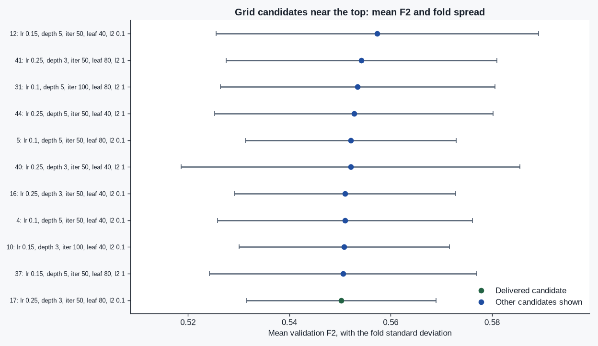
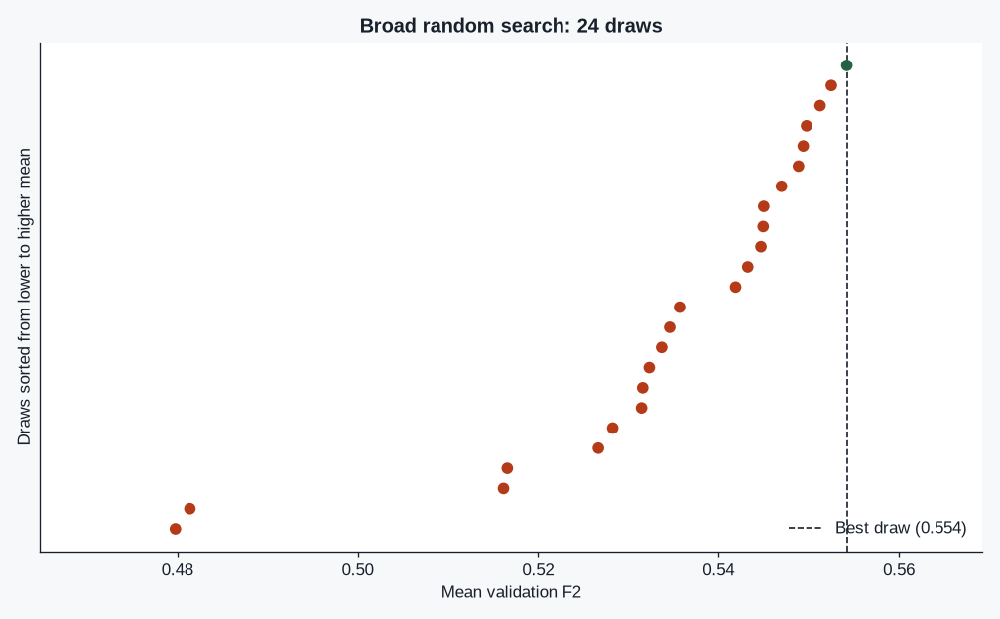

# StreamLoop — ajustando el modelo de cancelación

Clasificador de cancelación para el ejercicio StreamLoop: un `Pipeline` de scikit-learn con el preprocesamiento dentro, una línea base con hiperparámetros por defecto, luego `RandomizedSearchCV` y un `GridSearchCV` más estrecho. La búsqueda solo ve el entrenamiento. El test set se puntúa dos veces, con las mismas métricas.

La métrica de selección es F2 (beta=2) sobre `Churn=Yes`. Perder a un cliente que se va cuesta más que ofrecer retención a quien se habría quedado, así que accuracy no es lo que la búsqueda maximiza.

## Resultados de la última corrida

<!-- METRICS_TABLE_START -->
| Metric | Baseline | Tuned | Delta (tuned − baseline) |
| --- | ---: | ---: | ---: |
| F2 | 0.5473 | 0.5506 | +0.0033 |
| Recall (churn) | 0.5294 | 0.5267 | -0.0027 |
| Precision (churn) | 0.6326 | 0.6724 | +0.0398 |
<!-- METRICS_TABLE_END -->

<!-- DECISION_START -->
Hiperparámetros finales: `l2_regularization=0.1, learning_rate=0.25, max_depth=3, max_iter=50, min_samples_leaf=80`. Entrega: un solo fit sobre el entrenamiento del candidato más estable; no se llamó best_estimator_.fit. F2 de validación del candidato entregado: 0.5502 ± 0.0188.
<!-- DECISION_END -->

El argumento completo, la tabla de pliegues y los hiperparámetros están en [`tuning_report.md`](tuning_report.md). Gráficas de la misma corrida:







## Cómo ejecutarlo

Python 3.12. Las dependencias están fijadas en `requirements.txt` a las versiones con las que se corrió este estudio.

```bash
python -m pip install -r requirements.txt
python main.py
python -m pytest -q
```

`python main.py` descarga el CSV oficial (alrededor de 1 MB), comprueba su SHA-256, ajusta la línea base y las dos búsquedas, y reescribe el informe, `results/metrics.json`, las gráficas y las tablas de este archivo. En una máquina de 4 núcleos la búsqueda tarda unos minutos: 24 extracciones aleatorias y hasta 72 candidatos de rejilla, cada uno con 5 pliegues estratificados.

El notebook `streamloop_churn_tuning.ipynb` llama a la misma función `run_study`. Volver a ejecutarlo repite la búsqueda y escribe los mismos archivos. El comando está en el README en inglés.

## Datos

Se cargan desde la URL del enunciado. No hay una copia en el repositorio.

```
https://raw.githubusercontent.com/IBM/telco-customer-churn-on-icp4d/master/data/Telco-Customer-Churn.csv
```

SHA-256 fijado: `16320c9c1ec72448db59aa0a26a0b95401046bef5d02fd3aeb906448e3055e91` (7043 filas). El archivo está en `.gitignore`. No se versiona una tabla derivada ni un modelo serializado; `python main.py` regenera los agregados.

`TotalCharges` llega como texto y trae cadenas en blanco. Esa coerción ocurre dentro del pipeline. La mediana que rellena esos huecos se ajusta solo con las filas de entrenamiento.

## Qué hace la corrida

1. Divide 80/20, estratificado, `random_state=42`, antes de ajustar cualquier estimador.
2. Ajusta un `Pipeline`: quita `customerID`, convierte `TotalCharges`, imputa, codifica categorías y entrena `HistGradientBoostingClassifier` con los defaults de sklearn salvo `random_state=42`. Puntúa el test. Esa es la línea base.
3. `RandomizedSearchCV` sobre 1280 combinaciones (`n_iter=24`, `n_jobs=-1`, `refit=True`, `StratifiedKFold` de 5 pliegues).
4. Arma una rejilla local con las mejores filas de la búsqueda aleatoria y corre `GridSearchCV` con el mismo scoring, los mismos pliegues, `n_jobs=-1` y `refit=True`.
5. Lee medias y desviaciones de `cv_results_`. Dentro de una banda fijada de 0.01 de F2 de validación bajo la mejor media, se queda con la menor dispersión entre pliegues. Si esa fila es el campeón de refit, entrega `best_estimator_` sin volver a llamar `fit`. Si no, ajusta ese otro candidato una vez sobre el entrenamiento.
6. Puntúa el modelo entregado en el test una sola vez, con F2, recall y precision.

`n_jobs=-1` es el paralelismo de la búsqueda. Los hilos de OpenMP y BLAS quedan en 1 para que esos procesos no ocupen todos los núcleos a la vez.

La familia del clasificador es un punto de partida. Lo que evalúa el ejercicio es la búsqueda, la métrica y la razón por la que se conserva la configuración final.

## Estructura

| Ruta | Función |
| --- | --- |
| `main.py` | Entrada de línea de comandos. |
| `streamloop_churn_tuning.ipynb` | El mismo estudio, con la división, las búsquedas y la tabla de pliegues a la vista. |
| `src/streamloop/` | Contrato de datos, pipeline, búsqueda, estudio e informe. |
| `tests/test_tuning.py` | Fugas, scorer F2, regla de empate y una corrida mínima de punta a punta. |
| `tuning_report.md` | Comparación línea base vs ajustado, hiperparámetros finales y nota de estabilidad. |
| `results/metrics.json` | Solo agregados. Sin filas de clientes. |
| `docs/figures/` | Gráficas que escribe `python main.py`. |
| `server.py` | Boilerplate de python-hello, sin cambios. El estudio no lo usa. |
| `learn.json` | Metadatos oficiales del commit de syllabus citado en `PROVENANCE.md`. |
| `.github/workflows/tests.yml` | Pytest hermético. No descarga el CSV. |

## Procedencia

El boilerplate es https://github.com/4GeeksAcademy/python-hello en el commit `142f2a913162efafce897da8bf241fe690f60395`. Ese repositorio no es un template de GitHub y no trae archivo `LICENSE`. Este proyecto no inventa uno. Checksums y el commit del syllabus están en [`PROVENANCE.md`](PROVENANCE.md).

## Pruebas

`python -m pytest -q` construye una tabla sintética con las mismas columnas, comprueba que las estadísticas del imputer ignoran las filas apartadas, y comprueba que ambas búsquedas reciben solo la longitud del entrenamiento. Esa tabla no es el dataset de IBM y no se guarda como si lo fuera.
