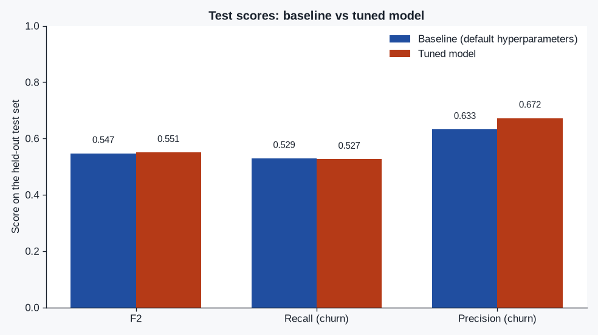
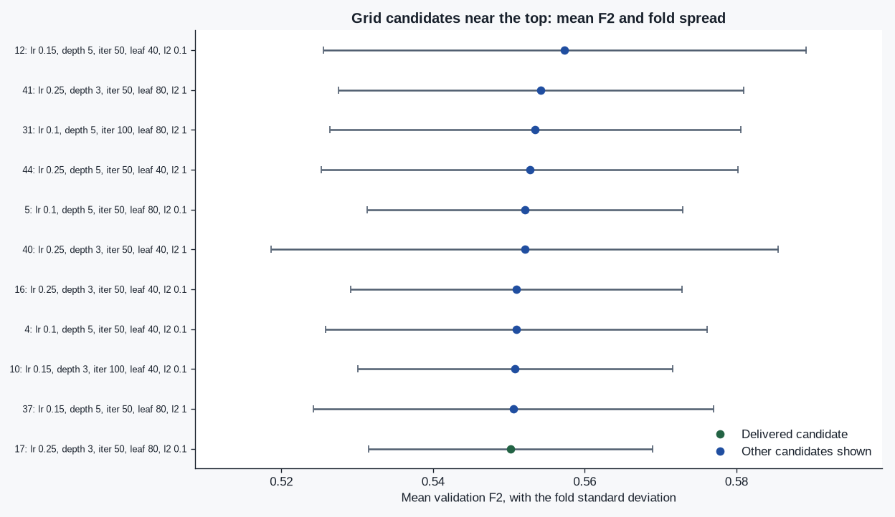
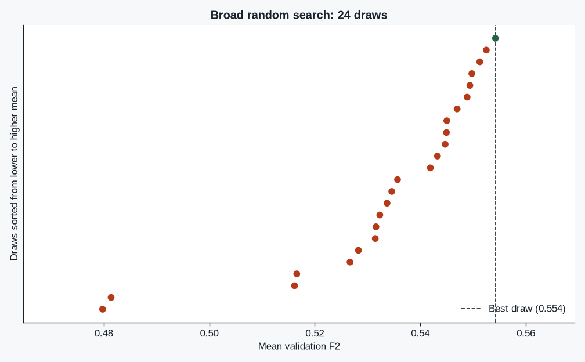

# StreamLoop — tuning the churn model

A churn classifier for the StreamLoop exercise: a scikit-learn `Pipeline` with preprocessing inside it, a default-hyperparameter baseline, then `RandomizedSearchCV` and a narrower `GridSearchCV`. The search sees only the training split. The held-out test set is scored twice, with the same metrics.

The selection metric is F2 (beta=2) on `Churn=Yes`. Missing a customer who leaves costs more than sending a retention offer to someone who would have stayed, so accuracy is not the score the search maximizes.

## Results of the last run

<!-- METRICS_TABLE_START -->
| Metric | Baseline | Tuned | Delta (tuned − baseline) |
| --- | ---: | ---: | ---: |
| F2 | 0.5473 | 0.5506 | +0.0033 |
| Recall (churn) | 0.5294 | 0.5267 | -0.0027 |
| Precision (churn) | 0.6326 | 0.6724 | +0.0398 |
<!-- METRICS_TABLE_END -->

<!-- DECISION_START -->
Final hyperparameters: `l2_regularization=0.1, learning_rate=0.25, max_depth=3, max_iter=50, min_samples_leaf=80`. Delivered via one training-split fit of the more stable grid candidate; best_estimator_.fit was not called. Validation F2 of the delivered candidate: 0.5502 ± 0.0188.
<!-- DECISION_END -->

The full argument, fold table, and hyperparameters are in [`tuning_report.md`](tuning_report.md). Charts from the same run:







## How to run

Python 3.12. Dependencies are pinned in `requirements.txt` to the versions this study was run with.

```bash
python -m pip install -r requirements.txt
python main.py
python -m pytest -q
```

`python main.py` downloads the official CSV (about 1 MB), checks its SHA-256, fits the baseline and both searches, and rewrites the report, the charts, the tables in this file, and a short `results/metrics.json` (headline metrics, final hyperparameters, and the CSV SHA-256). The full search dump is not part of the submission. On a 4-core machine the search is a few minutes: 24 random draws and up to 72 grid candidates, each with 5 stratified folds.

The notebook `streamloop_churn_tuning.ipynb` calls the same `run_study` function. Re-executing it repeats the search and writes the same files:

```bash
python - <<'PY'
import nbformat
from nbclient import NotebookClient
from pathlib import Path
path = Path("streamloop_churn_tuning.ipynb")
nb = nbformat.read(path, as_version=4)
NotebookClient(nb, timeout=1200, kernel_name="python3", resources={"metadata": {"path": str(Path('.').resolve())}}).execute()
nbformat.write(nb, path)
PY
```

## Data

Loaded from the URL in the project statement. Nothing is vendored.

```
https://raw.githubusercontent.com/IBM/telco-customer-churn-on-icp4d/master/data/Telco-Customer-Churn.csv
```

Pinned SHA-256: `16320c9c1ec72448db59aa0a26a0b95401046bef5d02fd3aeb906448e3055e91` (7043 rows). The file is gitignored. Do not commit a derived table or a pickled model; `python main.py` regenerates the aggregates.

`TotalCharges` is text and contains blank strings. Those blanks are coerced inside the pipeline. The median that fills them is fit on the training rows only.

## What the run does

1. Split 80/20, stratified, `random_state=42`, before any estimator is fit.
2. Fit a `Pipeline`: drop `customerID`, coerce `TotalCharges`, impute, one-hot encode, then `HistGradientBoostingClassifier` at sklearn defaults except `random_state=42`. Score the test set. That is the baseline.
3. `RandomizedSearchCV` over 1,280 combinations (`n_iter=24`, `n_jobs=-1`, `refit=True`, 5-fold `StratifiedKFold`).
4. Build a local grid from the top random-search rows and run `GridSearchCV` with the same scoring, folds, `n_jobs=-1`, and `refit=True`.
5. Read `cv_results_` means and fold standard deviations. Inside a pre-set band of 0.01 validation F2 under the best mean, keep the lowest fold spread. If that row is the refit champion, deliver `best_estimator_` without calling `fit` again. If not, fit that other candidate once on the training split.
6. Score the delivered model on the test set once, with F2, recall, and precision.

`n_jobs=-1` is the search parallelism. OpenMP and BLAS threads are pinned to 1 so those workers do not each take every core.

The classifier family is a starting point. The graded part of the exercise is the search, the metric, and the reason the final configuration was kept.

## Layout

| Path | Role |
| --- | --- |
| `main.py` | Command-line entry. |
| `streamloop_churn_tuning.ipynb` | Same study, with the split, the searches, and the fold table visible. |
| `src/streamloop/` | Data contract, pipeline, search, study, report. |
| `tests/test_tuning.py` | Leakage, F2 scorer, near-tie rule, and a tiny end-to-end run. |
| `tuning_report.md` | Baseline vs tuned comparison, final hyperparameters, stability note. |
| `results/metrics.json` | Short summary: baseline and tuned metrics, final hyperparameters, CSV SHA-256. |
| `docs/figures/` | Charts written by `python main.py`. |
| `server.py` | Unmodified python-hello boilerplate. Not used by the study. |
| `learn.json` | Official project metadata from the syllabus commit in `PROVENANCE.md`. |
| `.github/workflows/tests.yml` | Hermetic pytest. It does not download the CSV. |

## Provenance

The boilerplate is https://github.com/4GeeksAcademy/python-hello at commit `142f2a913162efafce897da8bf241fe690f60395`. That repository is not a GitHub template and it has no `LICENSE` file. This project does not add one. Details, checksums, and the syllabus commit are in [`PROVENANCE.md`](PROVENANCE.md).

## Tests

`python -m pytest -q` builds a synthetic table with the same columns, checks that imputation statistics ignore the held-out rows, and checks that both searches receive only the training length. The synthetic table is not the IBM dataset and is not written to disk as if it were.
