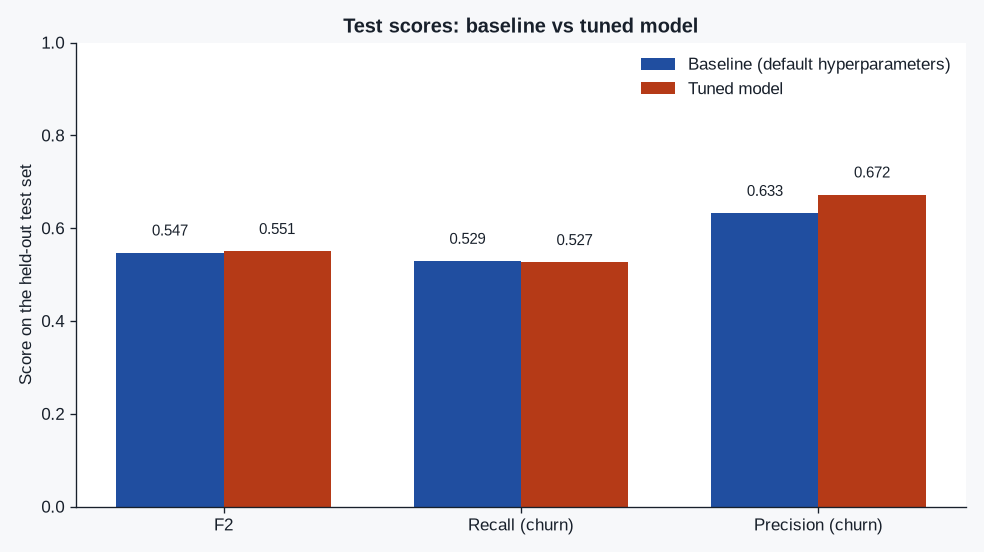
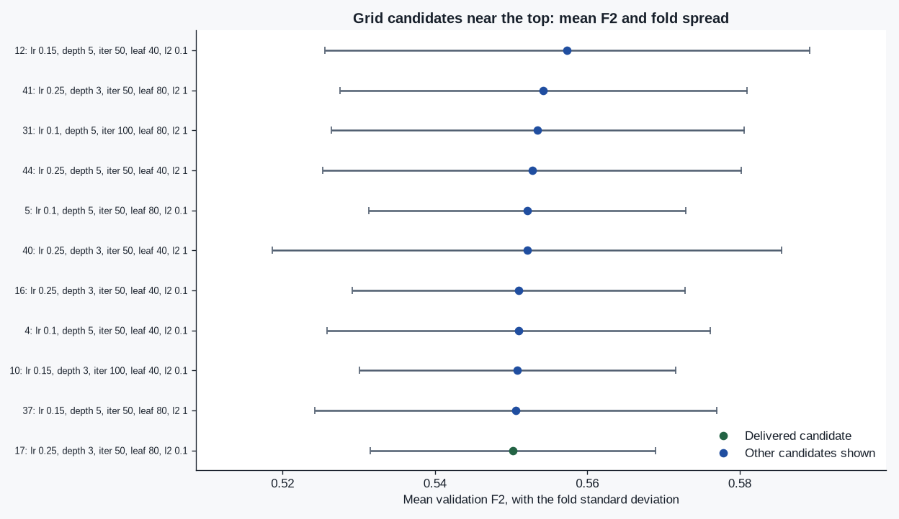
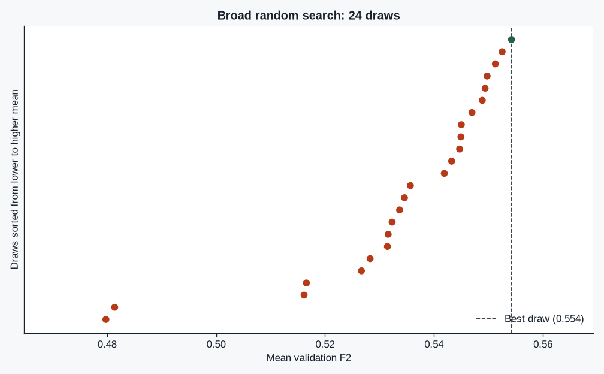

# Informe de ajuste: clasificador de cancelación de StreamLoop

Este informe compara la línea base con hiperparámetros por defecto y el modelo elegido tras una búsqueda aleatoria seguida de una rejilla. Las cifras salen de `results/metrics.json`, generado por `python main.py`.

## Resumen

| Metric | Baseline | Tuned | Delta (tuned − baseline) |
| --- | ---: | ---: | ---: |
| F2 | 0.5473 | 0.5506 | +0.0033 |
| Recall (churn) | 0.5294 | 0.5267 | -0.0027 |
| Precision (churn) | 0.6326 | 0.6724 | +0.0398 |

En el test set, el F2 ajustado supera al de la línea base por 0.0033. La línea base acierta 198 de 374 cancelaciones y dispara 115 alertas de más. El modelo final acierta 197 de 374 y dispara 96 alertas de más. Esa comparación no se usó para elegir hiperparámetros: el test set ya estaba cerrado.

Accuracy no es la métrica de selección. Con los conteos anteriores se puede reconstruir, y no es lo que la búsqueda maximizó.

## Por qué F2

StreamLoop pierde más dinero cuando un cliente cancela sin que nadie lo detecte que cuando una oferta de retención llega a alguien que se habría quedado. La búsqueda maximiza F2 (F-beta con beta=2) sobre la clase positiva Churn=Yes. F2 pesa más el recall que la precision. No se usa el accuracy por defecto de scikit-learn: trata los dos errores igual y queda inflado por el grupo más grande, el de quienes no cancelan.

El parámetro `scoring` de `RandomizedSearchCV` y de `GridSearchCV` es esa F2 (`beta=2`), no el accuracy por defecto de scikit-learn. `greater_is_better` queda en verdadero.

## Protocolo

- Dataset: `https://raw.githubusercontent.com/IBM/telco-customer-churn-on-icp4d/master/data/Telco-Customer-Churn.csv`. SHA-256: `16320c9c1ec72448db59aa0a26a0b95401046bef5d02fd3aeb906448e3055e91`. Filas: 7043. `TotalCharges` en blanco (conteo sobre el archivo, no una estadística del imputer): 11.
- División estratificada 80/20 con `random_state=42` **antes** de ajustar cualquier modelo: 5634 entrenamiento / 1409 test. Tasa de cancelación en el archivo: 0.2654. En entrenamiento: 0.2654.
- El identificador `customerID` se elimina dentro del `Pipeline`. `TotalCharges` se convierte a número dentro del `Pipeline`. La mediana de los numéricos y la moda de las categorías se ajustan solo con las filas que ve cada `fit`.
- Clasificador de partida: `HistGradientBoostingClassifier`. La arquitectura no es el objeto de la evaluación; el proceso de búsqueda sí.
- Validación cruzada: `StratifiedKFold(shuffle=True)`, 5 pliegues, `random_state=42`. La misma especificación se usa en la búsqueda aleatoria y en la rejilla.
- `n_jobs=-1` en ambas búsquedas. `refit=True` en ambas.
- La búsqueda aleatoria ve solo el entrenamiento. La rejilla ve solo el entrenamiento. El test set se puntúa exactamente dos veces: línea base y modelo final. Ledger: baseline, final.
- No se llama `fit` sobre `best_estimator_` después de la búsqueda.

## Línea base

Estimador: `HistGradientBoostingClassifier`. Hiperparámetros: defaults de scikit-learn, salvo `{'random_state': 42}`.

`random_state=42` fija la semilla; no entra en el espacio de búsqueda. El resto de hiperparámetros del modelo de la línea base son los de un constructor vacío de scikit-learn.

Test — F2 0.5473, recall 0.5294, precision 0.6326.

## Búsqueda aleatoria

`RandomizedSearchCV` extrajo 24 combinaciones de un espacio de 1280. `n_jobs=-1`, `refit=True`, CV de 5 pliegues.

Mejor media de validación: F2 0.5542 ± 0.0267. Parámetros: `l2_regularization=1, learning_rate=0.25, max_depth=3, max_iter=50, min_samples_leaf=80`.

Esas medias de validación, no el test set, deciden qué región merece una rejilla.

## Rejilla acotada

La rejilla se arma con los mejores resultados de `cv_results_` de la búsqueda aleatoria: el rango de valores del top y los vecinos de catálogo del mejor valor, con un tope por hiperparámetro. Quedan 48 candidatos (producto declarado 48), frente a 1280 del espacio amplio. El mejor punto aleatorio sigue dentro de la rejilla.

Espacio de la rejilla:

```
l2_regularization: 0.1, 1
learning_rate: 0.1, 0.15, 0.25
max_depth: 3, 5
max_iter: 50, 100
min_samples_leaf: 40, 80
```

`GridSearchCV` con `n_jobs=-1`, `refit=True`, los mismos pliegues. Mejor media según el ranking de scikit-learn (índice 12): F2 0.5574 ± 0.0318.

## Variación entre folds y modelo final

Entre los candidatos de la rejilla a como máximo 0.01 de F2 de validación de la mejor media, se elige la menor desviación entre pliegues. Si empatan, gana la media más alta y, si media y desviación coinciden, el campeón que ya reentrenó refit=True.

Campeón de `refit=True` (índice 12): media 0.5574, desviación 0.0318. Folds: 0.5505, 0.5045, 0.5974, 0.5820, 0.5524. Parámetros: `l2_regularization=0.1, learning_rate=0.15, max_depth=5, max_iter=50, min_samples_leaf=40`.

Candidato elegido (índice 17): media 0.5502, desviación 0.0188. Folds: 0.5342, 0.5216, 0.5679, 0.5648, 0.5626. Parámetros: `l2_regularization=0.1, learning_rate=0.25, max_depth=3, max_iter=50, min_samples_leaf=80`.

Diferencia de media (elegido − campeón): -0.0071. Diferencia de desviación: -0.0131. Tamaño de la banda de empate: 19 candidatos. `used_refit_best_estimator`: false.

La regla de estabilidad eligió un candidato distinto del campeón de refit. Se ajustó un pipeline nuevo una sola vez sobre el entrenamiento con esos hiperparámetros. No se llamó fit sobre best_estimator_.

Lectura de `cv_results_`: no se entrega el número de la media sin la desviación entre pliegues. Si la regla se queda con el campeón, es porque dentro de la banda su spread ya es el mejor (o empata). Si se queda con otro, se sacrifica como máximo 0.01 de F2 de validación a cambio de menos variación entre pliegues, y ese otro se entrena una vez sobre el entrenamiento.

### Candidatos de la rejilla

| Index | Role | Mean F2 | Fold std | Folds | Hyperparameters |
| ---: | --- | ---: | ---: | --- | --- |
| 12 | refit champion | 0.5574 | 0.0318 | 0.551, 0.505, 0.597, 0.582, 0.552 | `l2_regularization=0.1, learning_rate=0.15, max_depth=5, max_iter=50, min_samples_leaf=40` |
| 41 |  | 0.5542 | 0.0267 | 0.524, 0.519, 0.572, 0.582, 0.574 | `l2_regularization=1, learning_rate=0.25, max_depth=3, max_iter=50, min_samples_leaf=80` |
| 31 |  | 0.5535 | 0.0271 | 0.536, 0.511, 0.589, 0.573, 0.558 | `l2_regularization=1, learning_rate=0.1, max_depth=5, max_iter=100, min_samples_leaf=80` |
| 44 |  | 0.5528 | 0.0275 | 0.556, 0.501, 0.583, 0.563, 0.561 | `l2_regularization=1, learning_rate=0.25, max_depth=5, max_iter=50, min_samples_leaf=40` |
| 5 |  | 0.5521 | 0.0208 | 0.544, 0.516, 0.576, 0.566, 0.559 | `l2_regularization=0.1, learning_rate=0.1, max_depth=5, max_iter=50, min_samples_leaf=80` |
| 40 |  | 0.5521 | 0.0334 | 0.521, 0.507, 0.576, 0.596, 0.560 | `l2_regularization=1, learning_rate=0.25, max_depth=3, max_iter=50, min_samples_leaf=40` |
| 16 |  | 0.5510 | 0.0218 | 0.524, 0.531, 0.573, 0.578, 0.548 | `l2_regularization=0.1, learning_rate=0.25, max_depth=3, max_iter=50, min_samples_leaf=40` |
| 4 |  | 0.5510 | 0.0252 | 0.539, 0.508, 0.574, 0.574, 0.560 | `l2_regularization=0.1, learning_rate=0.1, max_depth=5, max_iter=50, min_samples_leaf=40` |
| 10 |  | 0.5508 | 0.0208 | 0.535, 0.519, 0.571, 0.571, 0.559 | `l2_regularization=0.1, learning_rate=0.15, max_depth=3, max_iter=100, min_samples_leaf=40` |
| 37 |  | 0.5506 | 0.0264 | 0.532, 0.508, 0.578, 0.573, 0.562 | `l2_regularization=1, learning_rate=0.15, max_depth=5, max_iter=50, min_samples_leaf=80` |
| 17 | delivered | 0.5502 | 0.0188 | 0.534, 0.522, 0.568, 0.565, 0.563 | `l2_regularization=0.1, learning_rate=0.25, max_depth=3, max_iter=50, min_samples_leaf=80` |
| 36 |  | 0.5497 | 0.0314 | 0.551, 0.499, 0.591, 0.572, 0.536 | `l2_regularization=1, learning_rate=0.15, max_depth=5, max_iter=50, min_samples_leaf=40` |
| 35 |  | 0.5497 | 0.0214 | 0.527, 0.522, 0.568, 0.573, 0.559 | `l2_regularization=1, learning_rate=0.15, max_depth=3, max_iter=100, min_samples_leaf=80` |
| 18 |  | 0.5494 | 0.0210 | 0.540, 0.525, 0.581, 0.567, 0.535 | `l2_regularization=0.1, learning_rate=0.25, max_depth=3, max_iter=100, min_samples_leaf=40` |
| 9 |  | 0.5492 | 0.0255 | 0.522, 0.514, 0.571, 0.571, 0.567 | `l2_regularization=0.1, learning_rate=0.15, max_depth=3, max_iter=50, min_samples_leaf=80` |
| 14 |  | 0.5489 | 0.0200 | 0.542, 0.520, 0.582, 0.554, 0.546 | `l2_regularization=0.1, learning_rate=0.15, max_depth=5, max_iter=100, min_samples_leaf=40` |
| 13 |  | 0.5486 | 0.0260 | 0.524, 0.512, 0.579, 0.565, 0.563 | `l2_regularization=0.1, learning_rate=0.15, max_depth=5, max_iter=50, min_samples_leaf=80` |
| 7 |  | 0.5480 | 0.0228 | 0.532, 0.523, 0.589, 0.553, 0.543 | `l2_regularization=0.1, learning_rate=0.1, max_depth=5, max_iter=100, min_samples_leaf=80` |
| 43 |  | 0.5479 | 0.0258 | 0.544, 0.507, 0.566, 0.583, 0.539 | `l2_regularization=1, learning_rate=0.25, max_depth=3, max_iter=100, min_samples_leaf=80` |
| 3 |  | 0.5473 | 0.0232 | 0.526, 0.514, 0.572, 0.557, 0.568 | `l2_regularization=0.1, learning_rate=0.1, max_depth=3, max_iter=100, min_samples_leaf=80` |
| 42 |  | 0.5472 | 0.0280 | 0.528, 0.508, 0.584, 0.572, 0.544 | `l2_regularization=1, learning_rate=0.25, max_depth=3, max_iter=100, min_samples_leaf=40` |
| 46 |  | 0.5470 | 0.0275 | 0.543, 0.495, 0.570, 0.569, 0.558 | `l2_regularization=1, learning_rate=0.25, max_depth=5, max_iter=100, min_samples_leaf=40` |
| 29 |  | 0.5469 | 0.0225 | 0.531, 0.511, 0.567, 0.569, 0.556 | `l2_regularization=1, learning_rate=0.1, max_depth=5, max_iter=50, min_samples_leaf=80` |
| 21 |  | 0.5466 | 0.0185 | 0.538, 0.524, 0.580, 0.546, 0.546 | `l2_regularization=0.1, learning_rate=0.25, max_depth=5, max_iter=50, min_samples_leaf=80` |
| 8 |  | 0.5458 | 0.0154 | 0.537, 0.523, 0.566, 0.560, 0.543 | `l2_regularization=0.1, learning_rate=0.15, max_depth=3, max_iter=50, min_samples_leaf=40` |
| 33 |  | 0.5457 | 0.0209 | 0.523, 0.520, 0.568, 0.568, 0.550 | `l2_regularization=1, learning_rate=0.15, max_depth=3, max_iter=50, min_samples_leaf=80` |
| 6 |  | 0.5453 | 0.0223 | 0.529, 0.513, 0.578, 0.549, 0.556 | `l2_regularization=0.1, learning_rate=0.1, max_depth=5, max_iter=100, min_samples_leaf=40` |
| 39 |  | 0.5450 | 0.0246 | 0.528, 0.510, 0.580, 0.563, 0.544 | `l2_regularization=1, learning_rate=0.15, max_depth=5, max_iter=100, min_samples_leaf=80` |
| 32 |  | 0.5449 | 0.0175 | 0.531, 0.526, 0.569, 0.563, 0.535 | `l2_regularization=1, learning_rate=0.15, max_depth=3, max_iter=50, min_samples_leaf=40` |
| 26 |  | 0.5439 | 0.0205 | 0.533, 0.510, 0.564, 0.563, 0.550 | `l2_regularization=1, learning_rate=0.1, max_depth=3, max_iter=100, min_samples_leaf=40` |
| 45 |  | 0.5435 | 0.0192 | 0.526, 0.522, 0.570, 0.562, 0.537 | `l2_regularization=1, learning_rate=0.25, max_depth=5, max_iter=50, min_samples_leaf=80` |
| 19 |  | 0.5424 | 0.0210 | 0.549, 0.512, 0.568, 0.559, 0.524 | `l2_regularization=0.1, learning_rate=0.25, max_depth=3, max_iter=100, min_samples_leaf=80` |
| 34 |  | 0.5421 | 0.0264 | 0.513, 0.513, 0.575, 0.568, 0.541 | `l2_regularization=1, learning_rate=0.15, max_depth=3, max_iter=100, min_samples_leaf=40` |
| 28 |  | 0.5420 | 0.0204 | 0.533, 0.511, 0.570, 0.557, 0.539 | `l2_regularization=1, learning_rate=0.1, max_depth=5, max_iter=50, min_samples_leaf=40` |
| 2 |  | 0.5418 | 0.0268 | 0.511, 0.507, 0.566, 0.557, 0.567 | `l2_regularization=0.1, learning_rate=0.1, max_depth=3, max_iter=100, min_samples_leaf=40` |
| 27 |  | 0.5416 | 0.0225 | 0.519, 0.510, 0.562, 0.557, 0.559 | `l2_regularization=1, learning_rate=0.1, max_depth=3, max_iter=100, min_samples_leaf=80` |
| 25 |  | 0.5415 | 0.0206 | 0.514, 0.524, 0.564, 0.565, 0.541 | `l2_regularization=1, learning_rate=0.1, max_depth=3, max_iter=50, min_samples_leaf=80` |
| 11 |  | 0.5411 | 0.0212 | 0.524, 0.510, 0.566, 0.561, 0.544 | `l2_regularization=0.1, learning_rate=0.15, max_depth=3, max_iter=100, min_samples_leaf=80` |
| 38 |  | 0.5411 | 0.0266 | 0.549, 0.496, 0.571, 0.561, 0.529 | `l2_regularization=1, learning_rate=0.15, max_depth=5, max_iter=100, min_samples_leaf=40` |
| 0 |  | 0.5409 | 0.0268 | 0.503, 0.518, 0.571, 0.567, 0.545 | `l2_regularization=0.1, learning_rate=0.1, max_depth=3, max_iter=50, min_samples_leaf=40` |
| 15 |  | 0.5404 | 0.0283 | 0.510, 0.504, 0.573, 0.565, 0.549 | `l2_regularization=0.1, learning_rate=0.15, max_depth=5, max_iter=100, min_samples_leaf=80` |
| 20 |  | 0.5397 | 0.0139 | 0.535, 0.524, 0.559, 0.553, 0.528 | `l2_regularization=0.1, learning_rate=0.25, max_depth=5, max_iter=50, min_samples_leaf=40` |
| 30 |  | 0.5388 | 0.0222 | 0.532, 0.510, 0.574, 0.551, 0.526 | `l2_regularization=1, learning_rate=0.1, max_depth=5, max_iter=100, min_samples_leaf=40` |
| 1 |  | 0.5381 | 0.0176 | 0.511, 0.525, 0.554, 0.558, 0.542 | `l2_regularization=0.1, learning_rate=0.1, max_depth=3, max_iter=50, min_samples_leaf=80` |
| 23 |  | 0.5359 | 0.0213 | 0.517, 0.513, 0.553, 0.568, 0.528 | `l2_regularization=0.1, learning_rate=0.25, max_depth=5, max_iter=100, min_samples_leaf=80` |
| 24 |  | 0.5346 | 0.0166 | 0.514, 0.519, 0.555, 0.552, 0.533 | `l2_regularization=1, learning_rate=0.1, max_depth=3, max_iter=50, min_samples_leaf=40` |
| 47 |  | 0.5334 | 0.0204 | 0.510, 0.509, 0.556, 0.554, 0.537 | `l2_regularization=1, learning_rate=0.25, max_depth=5, max_iter=100, min_samples_leaf=80` |
| 22 |  | 0.5305 | 0.0176 | 0.533, 0.496, 0.546, 0.540, 0.538 | `l2_regularization=0.1, learning_rate=0.25, max_depth=5, max_iter=100, min_samples_leaf=40` |

## Comparación en el test

Las mismas métricas que la línea base, en una sola pasada sobre el test set para el modelo final.

| Metric | Baseline | Tuned | Delta (tuned − baseline) |
| --- | ---: | ---: | ---: |
| F2 | 0.5473 | 0.5506 | +0.0033 |
| Recall (churn) | 0.5294 | 0.5267 | -0.0027 |
| Precision (churn) | 0.6326 | 0.6724 | +0.0398 |

## Hiperparámetros finales

```
l2_regularization=0.1, learning_rate=0.25, max_depth=3, max_iter=50, min_samples_leaf=80
```

Entrega: La regla de estabilidad eligió un candidato distinto del campeón de refit. Se ajustó un pipeline nuevo una sola vez sobre el entrenamiento con esos hiperparámetros. No se llamó fit sobre best_estimator_.

## Figuras







## Qué queda fuera de esta corrida

- Ni `RandomizedSearchCV` ni `GridSearchCV` ven el dataset completo ni el test set.
- El CSV oficial no se versiona. `python main.py` lo vuelve a descargar y comprueba su SHA-256.
- No se guarda un modelo serializado: el enunciado no pide el binario, y `python main.py` regenera métricas e informe.

Tiempos (segundos): `{'split_sec': 0.016, 'baseline_sec': 0.37, 'random_search_sec': 10.348, 'narrow_sec': 0.001, 'grid_search_sec': 9.934, 'select_and_final_sec': 0.143, 'total_sec': 20.816}`.

Versiones: scikit-learn 1.9.1, pandas 3.1.1.
